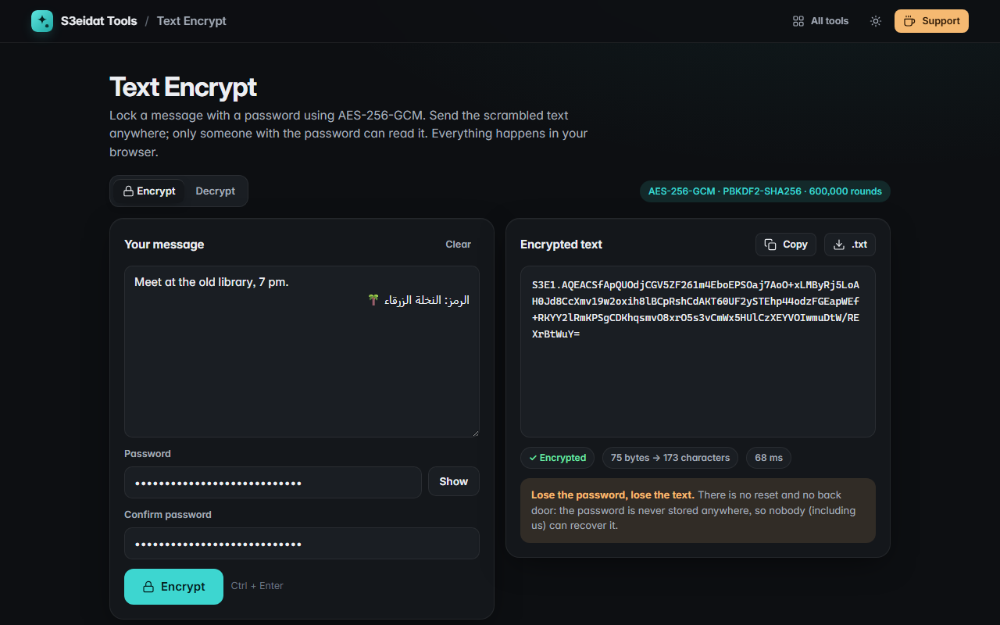

# Text Encrypt

> Encrypt a message with a password (AES-256-GCM). Free, private, and it runs entirely in your browser.

### ▶ [Open Text Encrypt](https://s3eidat.github.io/text-encrypt/)



## Features

- **Encrypt** any text (Arabic, emoji, anything UTF-8) into one copyable string that starts with `S3E1.`
- **Decrypt** it back with the same password, here or on any device
- **Tamper detection**: a wrong password, a changed character or a cut-off string gives a clear error, never garbage
- Password confirmation when encrypting, show/hide toggle, <kbd>Ctrl</kbd>+<kbd>Enter</kbd> to run
- Copy or download the result as `.txt`, open a `.txt` to decrypt

**If you lose the password, the text is gone.** There is no reset and no back door.

## Cryptography

All of it is the browser's built-in Web Crypto API (`crypto.subtle`); there is no custom crypto code.

| Part | Choice |
|---|---|
| Cipher | AES-256-GCM, 128-bit authentication tag |
| Key | PBKDF2-HMAC-SHA256, **600,000 iterations**, 16-byte random salt per message |
| IV | 12 random bytes per message (fresh salt means a fresh key every time, too) |
| Authenticated data | the whole header (version, KDF id, iterations, salt, IV), so none of it can be altered |
| Randomness | `crypto.getRandomValues` |

## Wire format (version 1)

```
S3E1.<base64>

base64 decodes to:
offset  size  field
0       1     version            = 0x01
1       1     kdf                = 0x01 (PBKDF2-HMAC-SHA256)
2       4     iterations         uint32 big-endian (600000 = 0x000927C0)
6       16    salt               random
22      12    iv                 random
34      n+16  AES-256-GCM ciphertext of the UTF-8 text, followed by the 16-byte tag
              AAD = bytes 0..33 (the header)
```

The key is `PBKDF2(password, NFC-normalized, as UTF-8, salt, iterations, SHA-256) → 32 bytes` (NFC means an "ä" typed on
macOS and on Windows gives the same key). The decoder accepts standard or URL-safe base64
and ignores whitespace and line breaks. It refuses iteration counts outside 100,000–10,000,000, so a crafted string
can't freeze your tab. Any future format will use a different prefix (`S3E2.`), so old messages keep working.

Decrypting it elsewhere, for example in Python:

```python
import base64, struct, hashlib, unicodedata
from cryptography.hazmat.primitives.ciphers.aead import AESGCM
raw = base64.b64decode(s.removeprefix("S3E1."))
iters = struct.unpack(">I", raw[2:6])[0]
key = hashlib.pbkdf2_hmac("sha256", unicodedata.normalize("NFC", password).encode(), raw[6:22], iters, 32)
text = AESGCM(key).decrypt(raw[22:34], raw[34:], raw[:34]).decode()
```

The built-in self-test checks: encrypt → decrypt round trip, unique output every time, wrong password fails,
a flipped ciphertext / salt / IV byte fails, a truncated string fails, absurd iteration counts are refused,
and a fixed known message still decrypts.

## Privacy

Your text and password never leave your device and are never stored (not even in local storage).
There is no server, no account, no analytics. The page ships with a strict Content-Security-Policy
(`connect-src 'self'`), so the browser itself blocks any attempt to send data anywhere.

## Run it yourself

It's plain HTML, CSS and JavaScript with no build step:

```bash
git clone https://github.com/s3eidat/text-encrypt
cd text-encrypt
python -m http.server 8000
```

Then open http://localhost:8000. (Web Crypto needs `https://` or `localhost`.)

## Support

If this saved you time, **[buy me a coffee ☕](https://s3eidat.github.io/coffee/)**. It keeps every tool free.

---

Part of **[S3eidat Tools](https://s3eidat.github.io/)**: 100+ free, private tools that run in your browser. MIT licensed.
